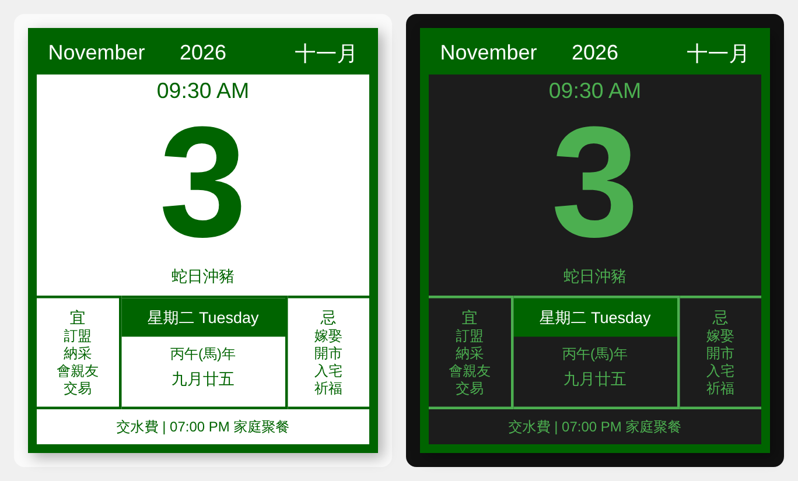

# hkcalendar

[中文](#中文) | [English](#english)

## 中文

傳統手撕日曆別具特色，也是傳統華人家庭必備的產品。我一直渴望在 Home Assistant 加入中式日曆卡片，顯示公曆、農曆、宜忌、沖煞、節氣、農曆節日、假期。假期與星期日會轉為假日顏色。所有日曆文字一律以繁體中文顯示，英文月份和星期作為裝飾保留，也與實際手撕日曆的樣式一致。數碼時代，我加上實際時間和當日日程的選項。

### 安裝

#### 方法一：自訂儲存庫

1. 在 HACS 右上角選單選「Custom repositories」，Repository 填 `https://github.com/Huiyuen07/hkcalendar`，Type 選「Dashboard」。
2. 在 HACS 搜尋「hkcalendar」並下載，然後重新整理瀏覽器。

#### 方法二：HACS 安裝（有待 HACS 審批）

HACS 批准後，不用加入自訂儲存庫，直接在 HACS 搜尋「hkcalendar」並下載，然後重新整理瀏覽器。

HACS 會自動加入資源，版本更新也在 HACS 完成。如果資源是用 YAML 管理，要自行加入 `/hacsfiles/hkcalendar/chinese-calendar-card.js`。

安裝後，在 Dashboard 新增卡片，搜尋「中式掛曆」。

### 鳴謝

- 農曆、宜忌、沖煞、節氣和農曆節日由 [6tail](https://github.com/6tail) 的 [lunar-javascript](https://github.com/6tail/lunar-javascript) 計算。
- 公眾假期來自 Home Assistant 的 [Holiday 整合](https://www.home-assistant.io/integrations/holiday/)，以及維護 [holidays](https://github.com/vacanza/holidays) 的社群。

### 授權

本專案以 [MIT 授權](LICENSE)發佈。

---

## English

The traditional tear-off calendar has a charm of its own, and it is a fixture of traditional Chinese homes. I have long wanted a Chinese calendar card in Home Assistant that shows the Gregorian and lunar dates, the daily almanac (宜／忌), zodiac clash, solar terms, lunar festivals and holidays. Holidays and Sundays turn to the holiday colour. All calendar text is in Traditional Chinese, with the English month and weekday kept as decoration, just like a real tear-off calendar. For the digital age, I added the current time and an option for today's events.

### Install

#### Option 1: Custom repository

1. In HACS, open the top-right menu and choose "Custom repositories". Enter `https://github.com/Huiyuen07/hkcalendar` as the repository and choose "Dashboard" as the type.
2. Search HACS for "hkcalendar", download it, then refresh the browser.

#### Option 2: HACS (awaiting HACS approval)

Once HACS approves it, there is no need to add a custom repository. Search HACS for "hkcalendar", download it, then refresh the browser.

HACS adds the resource for you and handles updates. If you manage resources in YAML, add `/hacsfiles/hkcalendar/chinese-calendar-card.js` yourself.

After installing, add a card to a dashboard and search for 「中式掛曆」.

### Acknowledgements

- The lunar date, almanac, zodiac clash, solar terms and lunar festivals are computed by [lunar-javascript](https://github.com/6tail/lunar-javascript) from [6tail](https://github.com/6tail).
- Public holidays come from Home Assistant's [Holiday integration](https://www.home-assistant.io/integrations/holiday/) and the community that maintains [holidays](https://github.com/vacanza/holidays).

### License

Released under the [MIT License](LICENSE).
